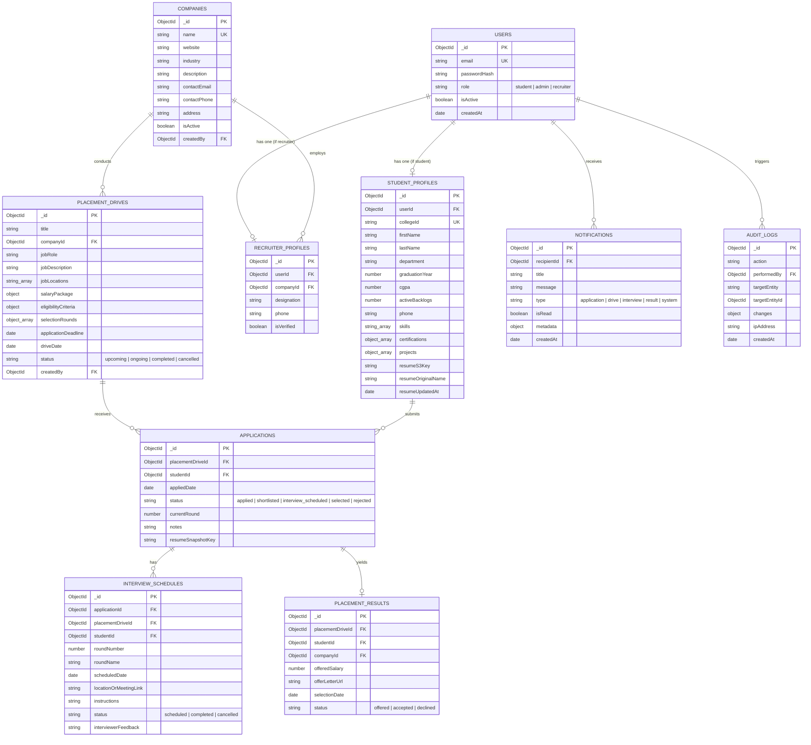

# Database Design & Entity Relationship Model

## 1. Overview

The Cloud-Based College Placement Management System uses MongoDB Atlas as its primary cloud data store. Schemas are defined using Mongoose with strict field validations, default values, references (ObjectId), and compound unique indexes to guarantee referential integrity and prevent duplicate applications.

---

## 2. Entity Relationship Diagram (ERD)

---

## 3. Detailed Collection Schemas

### 3.1 `users`
- `_id`: ObjectId (Primary Key)
- `email`: String, required, lowercase, trimmed, unique index.
- `passwordHash`: String, required (bcrypt hash, 60 chars).
- `role`: String, enum: `['student', 'admin', 'recruiter']`, required, index.
- `isActive`: Boolean, default: `true`.
- `createdAt`, `updatedAt`: Timestamps.

### 3.2 `student_profiles`
- `_id`: ObjectId (Primary Key)
- `userId`: ObjectId, ref: `User`, required, unique index.
- `collegeId`: String, required, uppercase, trimmed, unique index (e.g. "2023CS0104").
- `firstName`: String, required, trimmed.
- `lastName`: String, required, trimmed.
- `department`: String, required, enum: `['Computer Science', 'Information Technology', 'Electronics & Communication', 'Electrical Engineering', 'Mechanical Engineering', 'Civil Engineering']`.
- `graduationYear`: Number, required, index (e.g., 2026, 2027).
- `cgpa`: Number, required, min: 0.0, max: 10.0, index.
- `activeBacklogs`: Number, required, min: 0, default: 0.
- `phone`: String, required.
- `skills`: [String], index.
- `certifications`: [{ name: String, issuer: String, year: Number }].
- `projects`: [{ title: String, description: String, link: String }].
- `resumeS3Key`: String (S3 object key, private).
- `resumeOriginalName`: String.
- `resumeUpdatedAt`: Date.
- `createdAt`, `updatedAt`: Timestamps.

### 3.3 `companies`
- `_id`: ObjectId (Primary Key)
- `name`: String, required, unique, trimmed.
- `website`: String.
- `industry`: String, required.
- `description`: String.
- `logoUrl`: String.
- `contactEmail`: String, required.
- `contactPhone`: String.
- `address`: String.
- `isActive`: Boolean, default: true.
- `createdBy`: ObjectId, ref: `User`.
- `createdAt`, `updatedAt`: Timestamps.

### 3.4 `recruiter_profiles`
- `_id`: ObjectId (Primary Key)
- `userId`: ObjectId, ref: `User`, required, unique index.
- `companyId`: ObjectId, ref: `Company`, required, index.
- `designation`: String, required.
- `phone`: String.
- `isVerified`: Boolean, default: true.
- `createdAt`, `updatedAt`: Timestamps.

### 3.5 `placement_drives`
- `_id`: ObjectId (Primary Key)
- `title`: String, required.
- `companyId`: ObjectId, ref: `Company`, required, index.
- `jobRole`: String, required.
- `jobDescription`: String, required.
- `jobLocations`: [String], default: ['Bangalore', 'Hyderabad', 'Pune'].
- `salaryPackage`:
  - `ctc`: Number, required (Annual CTC in LPA/INR, e.g. 1200000).
  - `base`: Number.
  - `currency`: String, default: 'INR'.
  - `stipend`: Number, default: 0.
- `eligibilityCriteria`:
  - `minCgpa`: Number, required, min: 0, max: 10, default: 6.0.
  - `allowedDepartments`: [String], required.
  - `graduationYear`: Number, required.
  - `maxBacklogs`: Number, required, default: 0.
- `selectionRounds`: [{
  - `roundNumber`: Number,
  - `roundName`: String (e.g. 'Online Assessment', 'Technical Interview 1', 'HR Round'),
  - `description`: String
  }]
- `applicationDeadline`: Date, required.
- `driveDate`: Date, required.
- `status`: String, enum: `['upcoming', 'ongoing', 'completed', 'cancelled']`, default: 'upcoming', index.
- `createdBy`: ObjectId, ref: `User`.
- `createdAt`, `updatedAt`: Timestamps.

### 3.6 `applications`
- `_id`: ObjectId (Primary Key)
- `placementDriveId`: ObjectId, ref: `PlacementDrive`, required.
- `studentId`: ObjectId, ref: `StudentProfile`, required.
- `appliedDate`: Date, default: Date.now.
- `status`: String, enum: `['applied', 'shortlisted', 'interview_scheduled', 'selected', 'rejected']`, default: 'applied', index.
- `currentRound`: Number, default: 1.
- `notes`: String.
- `resumeSnapshotKey`: String.
- **Indexes**: Compound Unique Index: `{ placementDriveId: 1, studentId: 1 }` to guarantee no duplicate submissions.

### 3.7 `interview_schedules`
- `_id`: ObjectId (Primary Key)
- `applicationId`: ObjectId, ref: `Application`, required.
- `placementDriveId`: ObjectId, ref: `PlacementDrive`, required.
- `studentId`: ObjectId, ref: `StudentProfile`, required.
- `roundNumber`: Number, required.
- `roundName`: String, required.
- `scheduledDate`: Date, required.
- `locationOrMeetingLink`: String, required.
- `instructions`: String.
- `status`: String, enum: `['scheduled', 'completed', 'cancelled']`, default: 'scheduled'.
- `interviewerFeedback`: String.
- `createdAt`, `updatedAt`: Timestamps.

### 3.8 `placement_results`
- `_id`: ObjectId (Primary Key)
- `placementDriveId`: ObjectId, ref: `PlacementDrive`, required.
- `studentId`: ObjectId, ref: `StudentProfile`, required.
- `companyId`: ObjectId, ref: `Company`, required.
- `offeredSalary`: Number, required.
- `offerLetterUrl`: String.
- `selectionDate`: Date, default: Date.now.
- `status`: String, enum: `['offered', 'accepted', 'declined']`, default: 'offered'.
- `createdAt`, `updatedAt`: Timestamps.

### 3.9 `notifications`
- `_id`: ObjectId (Primary Key)
- `recipientId`: ObjectId, ref: `User`, required, index.
- `title`: String, required.
- `message`: String, required.
- `type`: String, enum: `['application', 'drive', 'interview', 'result', 'system']`, default: 'system'.
- `isRead`: Boolean, default: false, index.
- `metadata`: Schema.Types.Mixed.
- `createdAt`: Date, default: Date.now.

### 3.10 `audit_logs`
- `_id`: ObjectId (Primary Key)
- `action`: String, required (e.g., 'DRIVE_CREATED', 'STATUS_UPDATED').
- `performedBy`: ObjectId, ref: `User`, required.
- `targetEntity`: String, required.
- `targetEntityId`: ObjectId.
- `changes`: Schema.Types.Mixed.
- `ipAddress`: String.
- `createdAt`: Date, default: Date.now.
